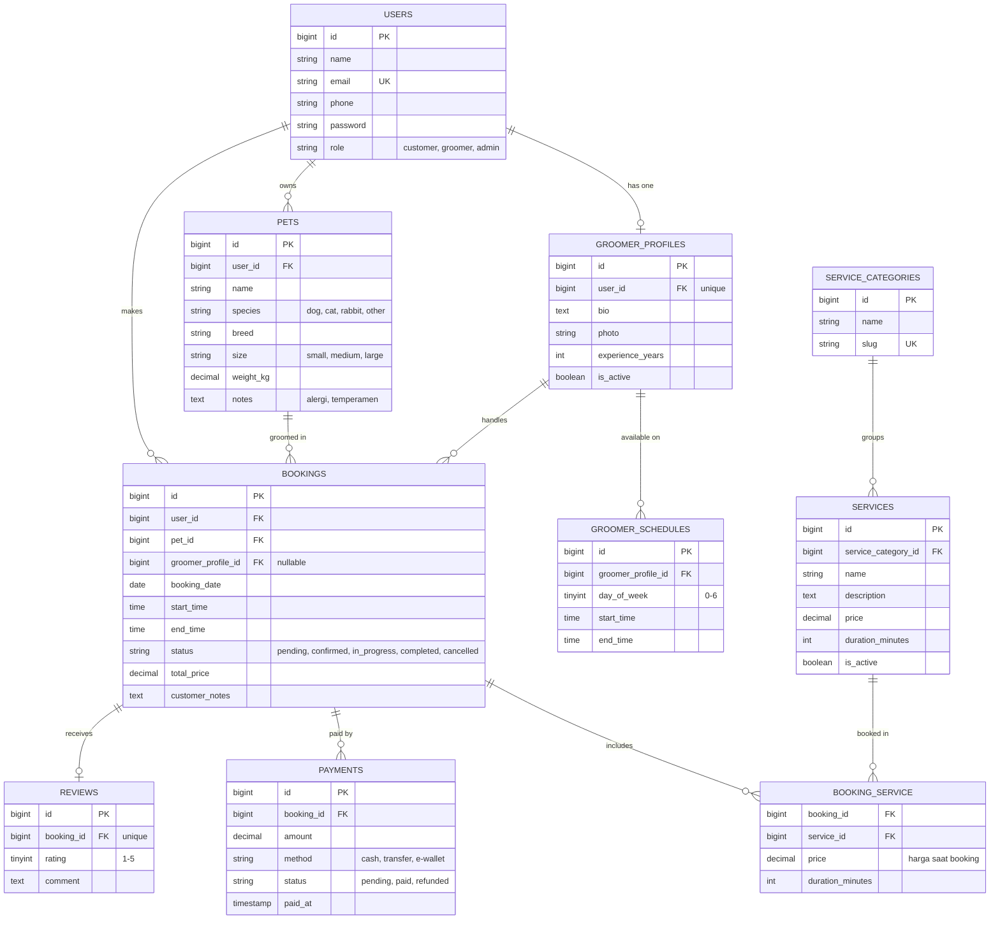

# Database Design — Entity Relationship Diagram

Dokumen ini menjelaskan skema database **Pawfect** (web booking grooming hewan) beserta seluruh relasi Eloquent yang dipakai di proyek.

## 1. Entity Relationship Diagram

## 2. Ringkasan Relasi

| Tipe | Relasi | Eloquent |
|---|---|---|
| One-to-One | `User` ↔ `GroomerProfile` | `hasOne` / `belongsTo` |
| One-to-One | `Booking` ↔ `Review` | `hasOne` / `belongsTo` |
| One-to-Many | `User` → `Pet` | `hasMany` / `belongsTo` |
| One-to-Many | `User` → `Booking` | `hasMany` / `belongsTo` |
| One-to-Many | `Pet` → `Booking` | `hasMany` / `belongsTo` |
| One-to-Many | `GroomerProfile` → `Booking` | `hasMany` / `belongsTo` |
| One-to-Many | `GroomerProfile` → `GroomerSchedule` | `hasMany` / `belongsTo` |
| One-to-Many | `ServiceCategory` → `Service` | `hasMany` / `belongsTo` |
| One-to-Many | `Booking` → `Payment` | `hasMany` / `belongsTo` |
| Many-to-Many + pivot data | `Booking` ↔ `Service` (pivot `booking_service`, kolom `price`, `duration_minutes`) | `belongsToMany` + `withPivot` |
| Has-Many-Through | `GroomerProfile` → `Review` through `Booking` (review yang diterima groomer) | `hasManyThrough` |

## 3. Layanan Awal (seeded)

Tabel `service_categories` dan `services` diisi lewat seeder. Contoh data awal:

| Kategori | Layanan | Durasi |
|---|---|---|
| Mandi | Mandi Basic | 45 menit |
| Mandi | Mandi Anti Kutu & Jamur | 60 menit |
| Potong | Potong Bulu / Trimming | 60 menit |
| Potong | Potong Kuku | 15 menit |
| Perawatan | Pembersihan Telinga | 15 menit |
| Perawatan | Sikat Gigi | 15 menit |
| Paket | Full Grooming | 120 menit |

## 4. Catatan Desain

- **Unique constraints:** `users.email`, `groomer_profiles.user_id`, `service_categories.slug`, `reviews.booking_id` (satu review per booking), dan (`booking_service.booking_id`, `booking_service.service_id`) agar satu layanan hanya tercatat sekali per booking.
- **Harga disalin ke pivot:** `booking_service.price` menyimpan harga saat booking dibuat, sehingga perubahan harga di `services` tidak mengubah booking lama. `bookings.total_price` dihitung dari pivot ini.
- **Cegah jadwal bentrok:** saat booking dibuat, sistem mengecek tumpang tindih `start_time`–`end_time` untuk groomer yang sama di tanggal yang sama. `end_time` dihitung dari jumlah `duration_minutes` layanan yang dipilih, dan slot harus berada dalam `groomer_schedules` groomer tersebut.
- **Groomer opsional:** `bookings.groomer_profile_id` nullable, sehingga admin dapat menugaskan groomer setelah booking masuk.
- **Hewan milik user:** `pets.user_id` memastikan pelanggan hanya bisa booking untuk hewannya sendiri (divalidasi lewat policy).
- **Status booking:** `pending` → `confirmed` → `in_progress` → `completed`, atau `cancelled` kapan saja sebelum `completed`. Review hanya boleh dibuat jika status `completed`.
- **Rating range:** `reviews.rating` menerima nilai 1 sampai 5, dipastikan lewat validasi.
- **Cascade rules:** menghapus user menghapus pets dan bookings miliknya. Menghapus booking menghapus pivot layanan, payments, dan review. Menghapus kategori atau layanan ditolak (restrict) selama masih dipakai.
- **Total** seperti rating rata-rata groomer dan pendapatan per hari dihitung dari `reviews`, `payments`, dan `bookings`, tidak disimpan.
